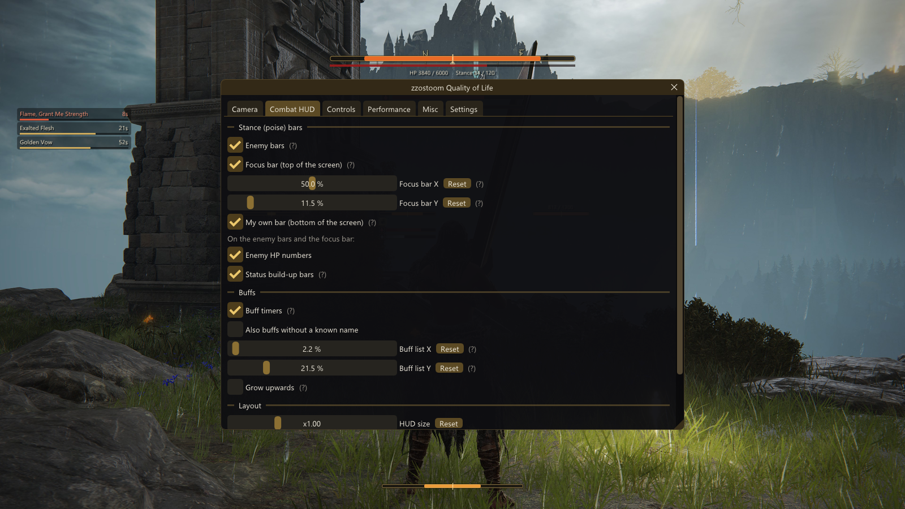
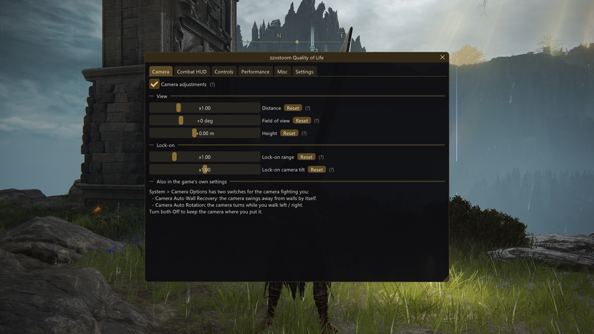
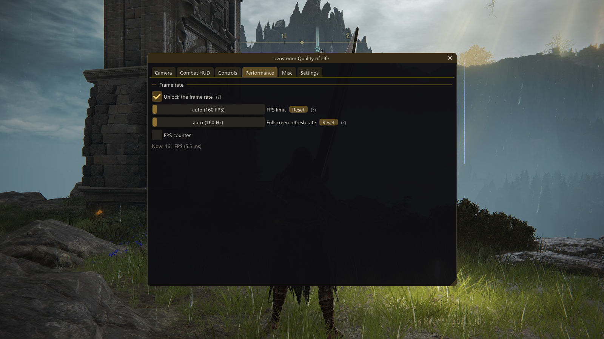
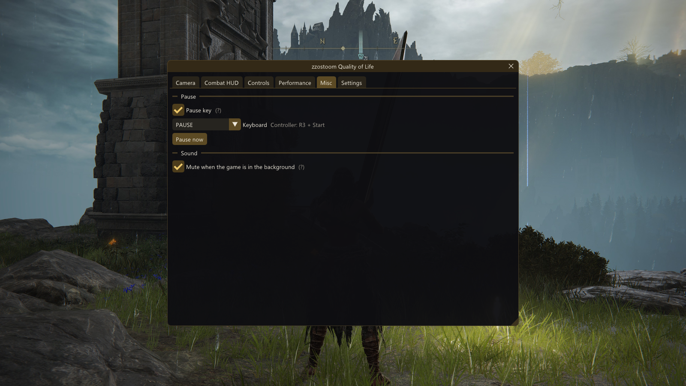
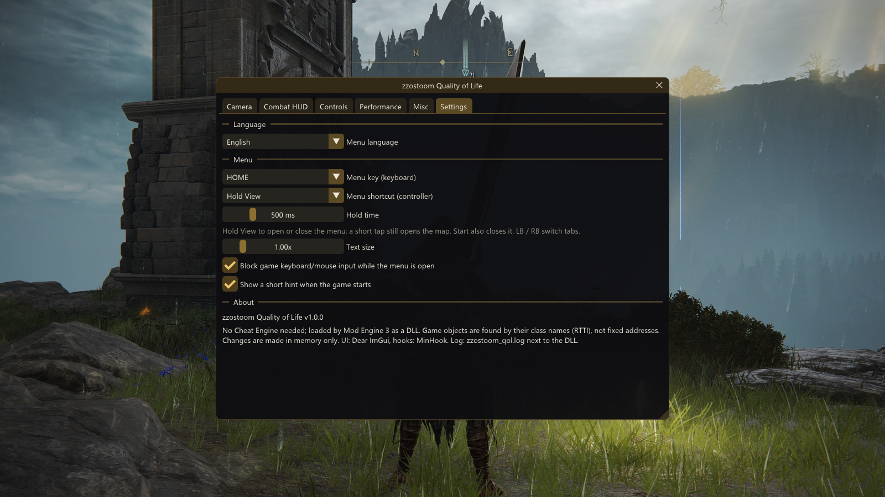
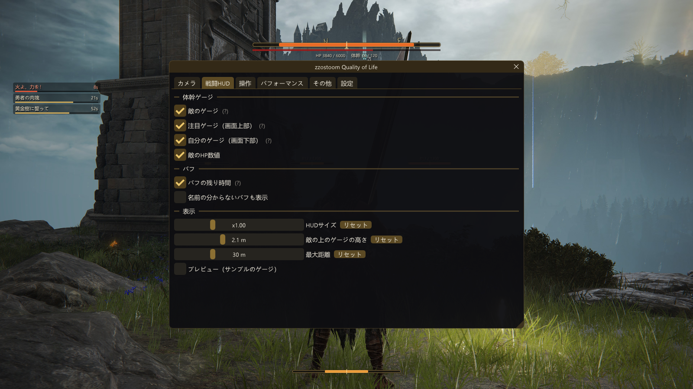
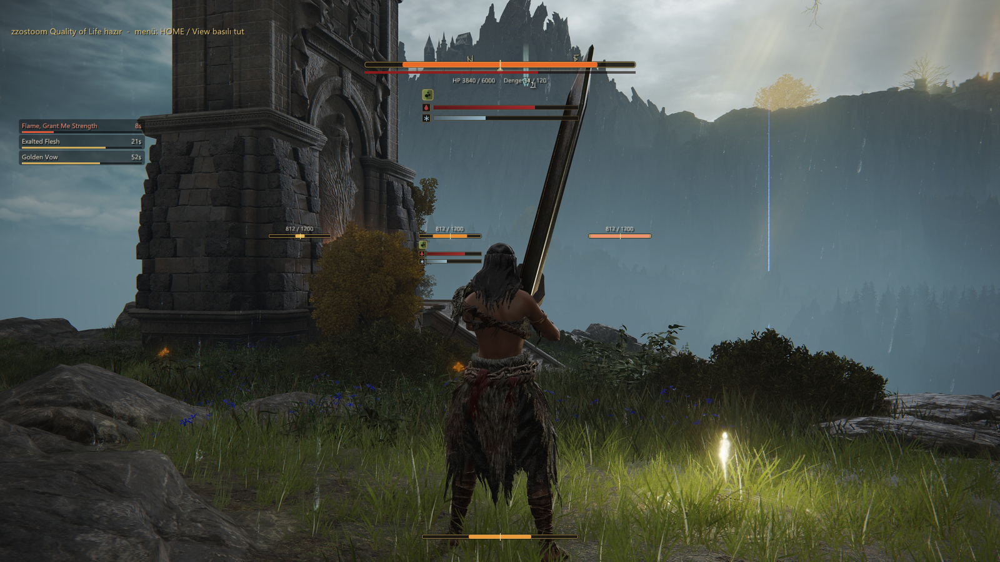

# zzostoom Quality of Life

**Camera, Sekiro-style stance bars, instant roll and FPS unlock for Elden Ring, in one in-game menu.**

Loaded by [Mod Engine 3](https://github.com/garyttierney/me3) as a DLL. Nothing is written to `regulation.bin` or any other game file: the mod edits the game in memory while it runs, so it works next to regulation mods and with **Seamless Co-op**. Keyboard/mouse and controller, menu in 10 languages.

**[Download the latest release](https://github.com/EneSuckSoi/zzostoom-quality-of-life/releases/latest)**



## Features

- **Camera**: distance, field of view, height, lock-on range and lock-on camera tilt. Applies to every camera in the game (on foot, on Torrent, boss arenas) and changes live.
- **Stance bars**: Sekiro-style poise bars above the enemies you fight, a big focus bar for the enemy you hit last (can be moved), your own poise bar, enemy HP numbers. Every part can be turned off.
- **Status build-up**: an icon and a bar under the enemy bars while blood loss, frostbite, poison, scarlet rot, sleep, madness or death blight builds up, and a lit icon with the time left while the enemy is poisoned, rotting, frostbitten or asleep.
- **Buff timers**: remaining time of your active buffs (Golden Vow, Flame Grant Me Strength, crystal tears, boluses, Ash of War buffs like Seppuku or War Cry...), named in your language. The list can be moved and can grow upwards.
- **Instant roll**: Elden Ring rolls when you *release* the dodge button, because holding it means sprint. With this on you roll the moment you press; keep holding to sprint. Controller only, off on Torrent.
- **Performance**: FPS unlock with an optional limit, higher refresh rate in exclusive fullscreen, FPS counter.
- **Pause** the game (PAUSE key / R3 + Start) with the game's own pause, while you are alone in your world, and **mute in background** when you Alt-Tab.
- **10 languages**: English, Deutsch, Français, Español, Português (Brasil), Русский, 日本語, 한국어, 简体中文, Türkçe. Follows your Windows language on the first start.

| | |
|---|---|
|  |  |
|  |  |
|  |  |
|  | |

## Requirements

- Elden Ring **1.17.1** (Steam, `eldenring.exe` 2.7.1.0)
- [Mod Engine 3](https://github.com/garyttierney/me3) (Mod Engine 2 works too)
- Windows 10/11, DirectX 12
- Optional: Seamless Co-op

## Installation

1. Close the game and download `zzostoom-quality-of-life-1.1.0.zip` from [Releases](https://github.com/EneSuckSoi/zzostoom-quality-of-life/releases/latest).
2. Copy `zzostoom_qol.dll` into your ME3 profile's mod folder, usually  
   `%LOCALAPPDATA%\garyttierney\me3\config\profiles\eldenring-mods\`
3. Open the `.me3` profile you launch the game with (e.g. `eldenring-default.me3`) and add:
   ```toml
   [[natives]]
   path = "eldenring-mods/zzostoom_qol.dll"
   ```
   The path is relative to the `.me3` file. Using Seamless Co-op? Keep its `ersc.dll` entry and add this one after it.
4. Start the game through ME3. "zzostoom Quality of Life ready" appears in the top-left corner.

Mod Engine 2: add the DLL to `external_dlls` in `config_eldenring.toml`. To uninstall, remove the lines and delete the DLL.

## Controls

| | Keyboard | Controller |
|---|---|---|
| Open / close menu | `HOME` (changeable) | hold `View` (changeable: View + Start, L3 + R3) |
| Navigate | mouse | D-pad / left stick, A change, LB/RB tabs, Start close |
| Pause | `PAUSE` (changeable) | `R3 + Start` |

A short tap on View still opens the map. Settings are saved in `zzostoom_qol.ini` next to the DLL. If something doesn't work, open an issue and attach `zzostoom_qol.log`.

## Seamless Co-op

- Camera, HUD, roll and FPS settings only affect your own game; every player can use different settings.
- Pause does nothing while other players are in your world, and the game resumes on its own if someone joins.
- If you see desync with unlocked FPS, try a 60 FPS limit.
- If UnlockTheFps is installed, the FPS part of this mod turns itself off.

**Offline / Seamless Co-op only.** Easy Anti-Cheat must be off; do not use it on the official online servers.

## Building from source

The DLL is built with the free [llvm-mingw](https://github.com/mstorsjo/llvm-mingw/releases) toolchain (UCRT, x86_64) and Python 3. No Visual Studio needed.

```bash
set ZZ_LLVM_MINGW=C:\path\to\llvm-mingw-ucrt-x86_64\bin
py build.py            # -> build/zzostoom_qol.dll
py build.py --install  # build and copy the DLL into the ME3 eldenring-mods folder
py build.py --test     # also build the controller filter unit test and the DX12 test window
```

| Folder | What's inside |
|---|---|
| `src/` | the mod: overlay (DX12 + ImGui), menu, camera params, stance bars, buffs, FPS, controller filter |
| `src/generated/` | buff names and menu text tables (generated) |
| `lang/` | menu translations, one `English<TAB>translation` file per language (`py -X utf8 tools/gen_lang.py` after editing) |
| `tools/` | generators for the buff and text tables |
| `test/` | controller filter unit test and DX12 test window |
| `third_party/` | Dear ImGui and MinHook |

Game objects are found by their RTTI class names and code patterns, not fixed addresses (`src/game.cpp`, `src/fps.cpp`); if a game update breaks something, start there.

## License and credits

Free to use. You may share, modify or build on it **only if you credit "zzostoom" and link to this repository** (https://github.com/EneSuckSoi/zzostoom-quality-of-life). Selling it is not allowed. See [LICENSE](LICENSE).

Made by **zzostoom**. Uses [Dear ImGui](https://github.com/ocornut/imgui) (MIT) and [MinHook](https://github.com/TsudaKageyu/minhook) (BSD 2-Clause), see [THIRD_PARTY_NOTICES.txt](THIRD_PARTY_NOTICES.txt). The pause uses the same method as techiew's [PauseTheGame](https://github.com/techiew/EldenRingMods) (MIT): it switches on the game's own tutorial pause.
